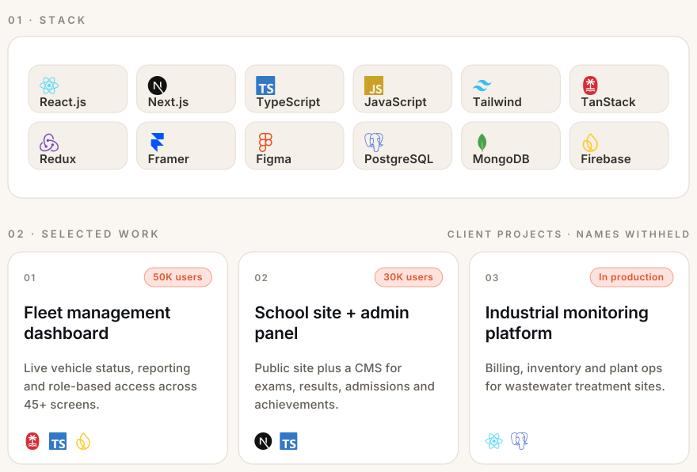

<picture>
  <source media="(prefers-color-scheme: dark)" srcset="https://raw.githubusercontent.com/it-is-amit/it-is-amit/main/assets/hero-dark.svg">
  <source media="(prefers-color-scheme: light)" srcset="https://raw.githubusercontent.com/it-is-amit/it-is-amit/main/assets/hero-light.svg">
  
</picture>

<picture>
  <source media="(prefers-color-scheme: dark)" srcset="https://raw.githubusercontent.com/it-is-amit/it-is-amit/main/assets/bento-dark.svg">
  <source media="(prefers-color-scheme: light)" srcset="https://raw.githubusercontent.com/it-is-amit/it-is-amit/main/assets/bento-light.svg">
  
</picture>

 

 

## Experience

| Role | Company | When |
| :--- | :--- | :--- |
| **Frontend Developer** | Product studio · Kota | Jul 2024 — Present |
| **Frontend Developer** | Startup · Jodhpur / Kota | May 2022 — May 2024 |
| **UI/UX Designer** | Startup · Kota | Jun 2021 — Apr 2022 |

 

## Contributions

<picture>
  <source media="(prefers-color-scheme: dark)" srcset="https://raw.githubusercontent.com/it-is-amit/it-is-amit/output/snake-dark.svg">
  <source media="(prefers-color-scheme: light)" srcset="https://raw.githubusercontent.com/it-is-amit/it-is-amit/output/snake.svg">
  
</picture>

 

## Open to

Senior Frontend / React / Next.js roles at product companies — India or remote. I like teams where frontend owns real surface area, not just tickets.

Artwork is hand-authored SVG — glyphs outlined, animated with SMIL, no third-party images. Built with <a href="https://github.com/it-is-amit/it-is-amit/blob/main/tools/build-artwork.py"><code>tools/build-artwork.py</code></a>.

