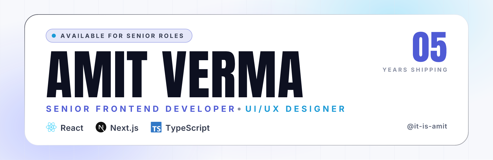
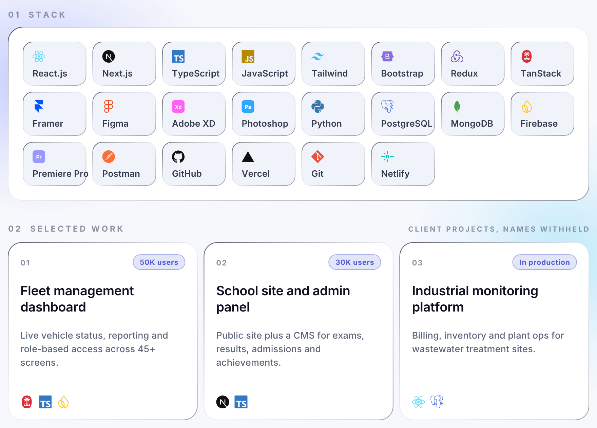
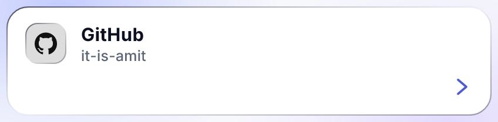
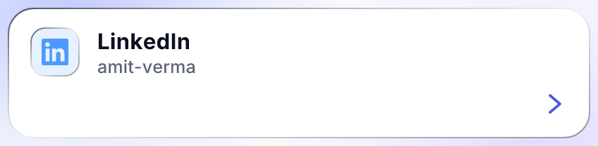
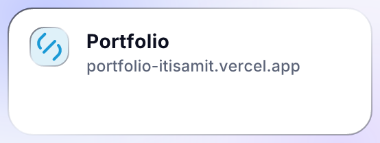
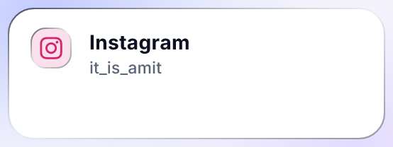
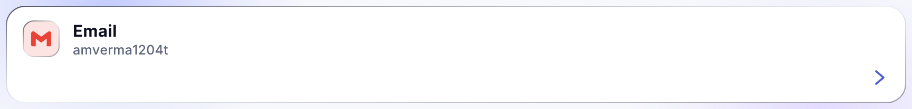

<picture>
  <source media="(prefers-color-scheme: dark)" srcset="https://raw.githubusercontent.com/it-is-amit/it-is-amit/main/assets/hero-dark.png">
  <source media="(prefers-color-scheme: light)" srcset="https://raw.githubusercontent.com/it-is-amit/it-is-amit/main/assets/hero-light.png">
  
</picture>

 
 

<picture>
  <source media="(prefers-color-scheme: dark)" srcset="https://raw.githubusercontent.com/it-is-amit/it-is-amit/main/assets/bento-dark.png">
  <source media="(prefers-color-scheme: light)" srcset="https://raw.githubusercontent.com/it-is-amit/it-is-amit/main/assets/bento-light.png">
  
</picture>

 
 

## I build interfaces that are designed, not just coded.

Five years in frontend, four of them in **React, Next.js and TypeScript**. I started out as a UI/UX designer, so hierarchy, motion and the pixel still lead every decision, and I care just as much about the component architecture underneath.

 

## Find me

<table width="100%">
<tr>
<td width="50%" align="center">
<a href="https://github.com/it-is-amit">
<picture>
  <source media="(prefers-color-scheme: dark)" srcset="https://raw.githubusercontent.com/it-is-amit/it-is-amit/main/assets/social-github-dark.png">
  <source media="(prefers-color-scheme: light)" srcset="https://raw.githubusercontent.com/it-is-amit/it-is-amit/main/assets/social-github-light.png">
  
</picture>
</a>
</td>
<td width="50%" align="center">
<a href="https://www.linkedin.com/in/amit-verma-2a46971b4/">
<picture>
  <source media="(prefers-color-scheme: dark)" srcset="https://raw.githubusercontent.com/it-is-amit/it-is-amit/main/assets/social-linkedin-dark.png">
  <source media="(prefers-color-scheme: light)" srcset="https://raw.githubusercontent.com/it-is-amit/it-is-amit/main/assets/social-linkedin-light.png">
  
</picture>
</a>
</td>
</tr>
<tr>
<td width="50%" align="center">
<a href="https://portfolio-itisamit.vercel.app/">
<picture>
  <source media="(prefers-color-scheme: dark)" srcset="https://raw.githubusercontent.com/it-is-amit/it-is-amit/main/assets/social-link-dark.png">
  <source media="(prefers-color-scheme: light)" srcset="https://raw.githubusercontent.com/it-is-amit/it-is-amit/main/assets/social-link-light.png">
  
</picture>
</a>
</td>
<td width="50%" align="center">
<a href="https://www.instagram.com/it_is_amit">
<picture>
  <source media="(prefers-color-scheme: dark)" srcset="https://raw.githubusercontent.com/it-is-amit/it-is-amit/main/assets/social-instagram-dark.png">
  <source media="(prefers-color-scheme: light)" srcset="https://raw.githubusercontent.com/it-is-amit/it-is-amit/main/assets/social-instagram-light.png">
  
</picture>
</a>
</td>
</tr>
<tr>
<td colspan="2" align="center">
<a href="mailto:amverma1204t@gmail.com">
<picture>
  <source media="(prefers-color-scheme: dark)" srcset="https://raw.githubusercontent.com/it-is-amit/it-is-amit/main/assets/social-gmail-dark.png">
  <source media="(prefers-color-scheme: light)" srcset="https://raw.githubusercontent.com/it-is-amit/it-is-amit/main/assets/social-gmail-light.png">
  
</picture>
</a>
</td>
</tr>
</table>

 

## Experience

| Role | Company | When |
| :--- | :--- | :--- |
| **Frontend Developer** | Kriscent Techno Hub, Kota | Jul 2024 to Present |
| **Frontend Developer** | Vysion Technology, Jodhpur / Kota | May 2022 to May 2024 |
| **UI/UX Designer** | Vysion Technology, Kota | Jun 2021 to Apr 2022 |
| **UI/UX Design Intern** | Safal Infotech Pvt. Ltd., Kota | Jan 2021 to May 2021 |

 

## More Projects

Beyond the three above, I have built and shipped frontends for:

- **E-commerce storefront** · Next.js with responsive product browsing, around 5,000 users
- **Social media platform** · reusable component architecture built to scale
- **Ad listing landing page** · Next.js and Tailwind CSS
- **AI astrology platform** · UI/UX overhaul for astrologers plus the frontend
- **AttachClub admin dashboard** · admin panel and user profile platform
- **Company website rebuild** · static site generation for a cPanel host, including SEO and performance work

 

## Contributions

<picture>
  <source media="(prefers-color-scheme: dark)" srcset="https://raw.githubusercontent.com/it-is-amit/it-is-amit/output/snake-dark.svg">
  <source media="(prefers-color-scheme: light)" srcset="https://raw.githubusercontent.com/it-is-amit/it-is-amit/output/snake.svg">
  
</picture>

 

## Open to

**Senior Frontend, React and Next.js** roles at product companies, in India or remote. I like teams where frontend owns real surface area, not just tickets.

