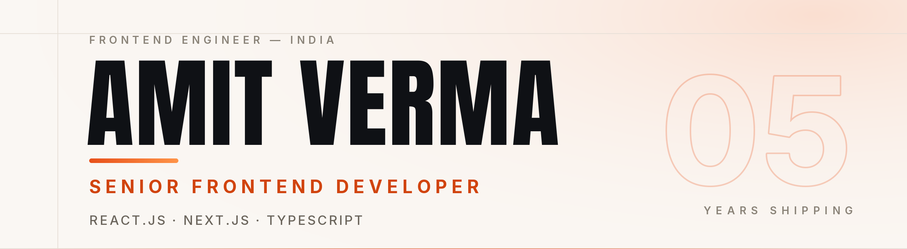

<div align="center">

<picture>
  <source media="(prefers-color-scheme: dark)" srcset="https://raw.githubusercontent.com/it-is-amit/it-is-amit/main/assets/hero-dark.png">
  <source media="(prefers-color-scheme: light)" srcset="https://raw.githubusercontent.com/it-is-amit/it-is-amit/main/assets/hero-light.png">
  
</picture>

<br/>


<br/>

<a href="https://www.linkedin.com/in/amit-verma-2a46971b4/"></a>
<a href="mailto:amverma1204t@gmail.com"></a>
<a href="https://github.com/it-is-amit"></a>
<a href="https://komarev.com"></a>

</div>

---

### `$ whoami`

```ts
const amit = {
  role:       "Senior Frontend Developer",
  stack:      ["React.js", "Next.js", "TypeScript"],
  experience: "5 years total · 4+ years in frontend",
  location:   "Rajasthan, India · open to remote (India)",
  focus:      ["reusable component architecture", "SEO", "performance", "responsive UI"],
  background: "started as a UI/UX designer — ships interfaces that are designed, not just coded",
  currently:  "building dashboards and product UIs used by 5K–50K+ users",
  openTo:     "Senior Frontend / React / Next.js roles at product companies",
} as const;
```

I'm a frontend developer who came up through design. That means I care about the pixel, the interaction and the architecture in the same pass — and I'd rather ship a component system that survives ten more features than a screen that looks good once.

I work mostly in **Next.js + TypeScript**, across **CSR, SSR and SSG**, with **TanStack Query / Redux Toolkit** for data and **Tailwind CSS** for styling. I've built and shipped frontends for a fleet management dashboard, an industrial monitoring platform, a school website + admin panel, an e-commerce store and a social platform — the largest of those serves **~50,000 users**, with several others in the **5K–30K** range.

---

### `$ cat stack.json`

<div align="center">

**Languages & Core**


**Frameworks & Data**


**Backend, Database & Tooling**


**Design**


<br/><br/>

`TanStack Query` · `React Hook Form` · `Shadcn UI` · `Framer Motion` · `REST APIs` · `Axios` · `CSR / SSR / SSG` · `SEO` · `Performance`

</div>

---

### `$ git log --graph --all`

<div align="center">


<br/>


<br/>


</div>

---

### `$ ./contributions --snake`

<div align="center">

<picture>
  <source media="(prefers-color-scheme: dark)" srcset="https://raw.githubusercontent.com/it-is-amit/it-is-amit/output/snake-dark.svg">
  <source media="(prefers-color-scheme: light)" srcset="https://raw.githubusercontent.com/it-is-amit/it-is-amit/output/snake.svg">
  
</picture>

</div>

---

<div align="center">

### Hiring, or just curious? Let's talk.

I'm open to **Senior Frontend / React / Next.js** roles at product companies in India and remote.

<a href="mailto:amverma1204t@gmail.com"></a>
<a href="https://www.linkedin.com/in/amit-verma-2a46971b4/"></a>

<sub>Banner designed by hand · Interface built and tuned by hand.</sub>

</div>
